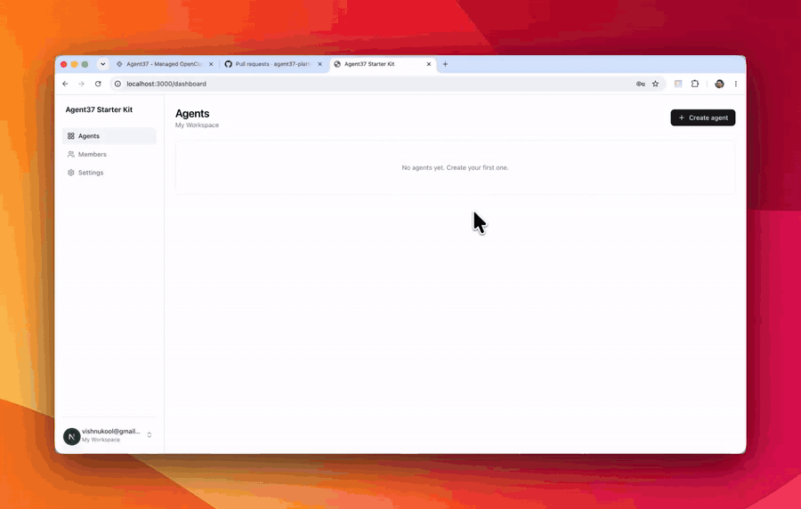

# Custom agent image

The [Agent37 Starter Kit](https://github.com/agent37-platform/starter-kit) — a working
agent app with auth, chat, files and integrations — running on **your own custom Docker image**
 as a template.

<p align="center">
  
</p>

The whole example is one folder:

```
template/
  Dockerfile                     FROM Hermes, + a CLI, + a skill
  skills/baked-in/SKILL.md       the skill
```

Edit those, run `npm run release:agent`, and every agent the app creates runs your
image. Agent37 builds it — no Docker on your machine, nothing pushed to a registry.

## Setup

**1. Get two keys** (both behind a login, so only you can fetch them):

- `AGENT37_API_KEY` — Agent37 dashboard → **Cloud → API keys**, then **fund the wallet** (Cloud → Billing).
- `SUPABASE_ACCESS_TOKEN` — [supabase.com/dashboard/account/tokens](https://supabase.com/dashboard/account/tokens).

**2. Hand it to your coding agent.** Open this folder in Claude Code / Codex and paste:

```
Set this repo up and run it locally, end to end — follow SETUP.md. Ask me for the two
login-gated keys it needs, then do everything else and tell me the local URL.
```

Or do it yourself:

```bash
npm install
npm run setup     # keys → Supabase → builds and publishes template/
npm run dev       # http://localhost:3000
```

Create an agent, then ask it **"what's baked into you?"** — it reports the CLI and the
skill from `template/`.

## Make it yours

1. Edit `template/Dockerfile` (install anything; bake it into `/usr/local`, never `/home`).
2. Add or replace skills under `template/skills/`.
3. `npm run release:agent` — new agents get the new image; existing ones update from Settings.

Details, rules and pitfalls: [AGENTS.md](AGENTS.md) ·
[Build a custom image](https://www.agent37.com/docs/agents-api/custom-image) ·
[SETUP.md](SETUP.md) for deploying.
